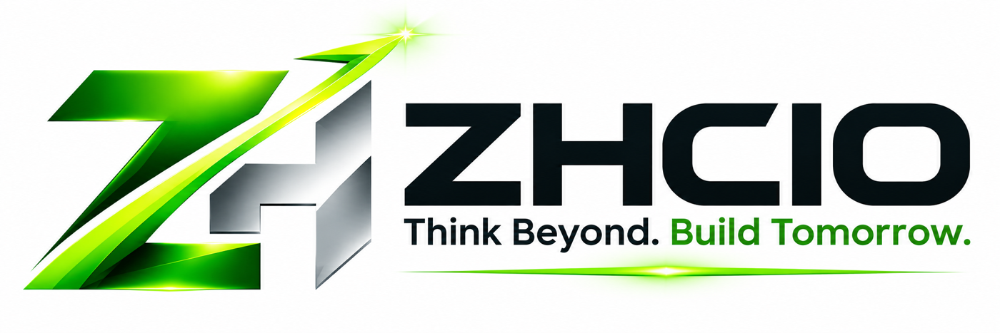

  

<a href="#english">English</a> · <a href="#français">Français</a>

**AI · IT Architecture · Cybersecurity · Automation · Innovation**

> Exploring what lies beyond today's technology to imagine, design and build tomorrow's digital world.

## About ZHCIO

ZHCIO is my personal space for exploring emerging technologies, challenging established approaches, and turning ideas into practical solutions.

My interests span artificial intelligence, agentic systems, enterprise architecture, cybersecurity, infrastructure and open-source innovation.

## Areas of exploration

- **AI & Agents** — Local AI, LLM gateways, RAG, orchestration and intelligent workflows.
- **IT Architecture** — Secure, scalable and maintainable technology platforms.
- **Cybersecurity** — Security by design, identity, access and resilience.
- **Automation** — Connecting systems and reducing operational complexity.
- **Innovation** — Prototyping, testing and sharing practical experiments.

## Projects

Repositories and demonstrations will be published here progressively.

## Philosophy

**Think Beyond.** Question assumptions and explore what comes next.

**Build Tomorrow.** Turn promising ideas into useful, responsible technology.

*Independent projects and opinions. No confidential employer information is published here.*

---

## Français

**IA · Architecture IT · Cybersécurité · Automatisation · Innovation**

> Explorer ce qui se trouve au-delà des technologies d'aujourd'hui pour imaginer, concevoir et construire le monde numérique de demain.

### À propos de ZHCIO

ZHCIO est mon espace personnel pour explorer les technologies émergentes, remettre en question les approches établies et transformer les idées en solutions concrètes.

Mes centres d'intérêt couvrent l'intelligence artificielle, les systèmes agentiques, l'architecture d'entreprise, la cybersécurité, les infrastructures et l'innovation open source.

### Domaines d'exploration

- **IA & Agents** — IA locale, passerelles LLM, RAG, orchestration et workflows intelligents.
- **Architecture IT** — Plateformes technologiques sécurisées, évolutives et maintenables.
- **Cybersécurité** — Sécurité dès la conception, identité, accès et résilience.
- **Automatisation** — Interconnecter les systèmes et réduire la complexité opérationnelle.
- **Innovation** — Prototyper, tester et partager des expérimentations concrètes.

### Projets

Les dépôts et démonstrations seront publiés ici au fil du temps.

### Philosophie

**Think Beyond.** Questionner les certitudes et explorer ce qui vient ensuite.

**Build Tomorrow.** Transformer les idées prometteuses en technologies utiles et responsables.

*Projets et opinions indépendants. Aucune information confidentielle d'employeur n'est publiée ici.*
